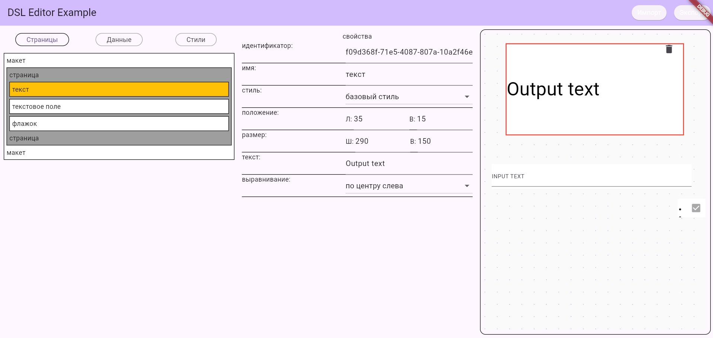

# Frame Forge

[](https://github.com/itjn-ru/frame_forge/blob/main/README.md)
[](https://github.com/itjn-ru/frame_forge/blob/main/README.ru.md)

## Description

This package offers a visual editor for designing and rendering user interfaces.  
At its core, it uses XML to define the UI structure, making it ideal for applications that rely on structured documents. Originally developed for document-centric workflows, it seamlessly supports Backend-Driven UI (BDUI) architectures, enabling dynamic UI generation from backend data.

## Demo
[Check it out here](https://itjn-ru.github.io/frame_forge/)

## Features

### Visual UI Designer
- **Drag & Drop Interface** - Intuitive visual editor for composing layouts
- **Real-time Preview** - See changes instantly as you design
- **Multi-screen Support** - Design for mobile, tablet, and desktop simultaneously
- **Grid-based Layout** - Precise positioning with snap-to-grid functionality
- **Unified page/component tree** - `PageList` renders pages and their components as one expandable tree: pages start collapsed, per-node expand/collapse, search across pages and components with auto-revealed matching branches, expand-all/collapse-all buttons, selection reveal (canvas picks scroll the tree to the item), quick switcher **Ctrl+K**, rename/duplicate/delete pages (all undoable), expansion memory per session
- **Collapsible component tree** - `Items` renders components and nested items as an expandable/collapsible list: first level visible by default, per-node expand/collapse, search with auto-revealed matching branches, expand-all/collapse-all buttons, selection reveal (canvas picks scroll the tree to the item), expansion memory per session
- **Data page as a table** - fullscreen Excel-like editor for sourcePage variables: inline cell editing (name/type/nullable/possible values), collapsible group sections, search and type filter, TSV copy/paste with Excel, rename with source-reference sync, all structural changes undoable

### Architecture & Integration
- **XML-based Structure** - Clean, readable markup defines UI components and properties
- **BDUI (Backend-Driven UI)** - Server controls the UI without client app updates
- **Dynamic Rendering** - Interface generated from server-provided data at runtime
- **Service-oriented Architecture** - Modular design with dependency injection

### Developer Experience
- **Undo/Redo System** - Full history management with keyboard shortcuts (Ctrl+Z/Ctrl+Y)
- **Copy/Paste Operations** - Duplicate components and layouts efficiently
- **Global Keyboard Handlers** - International keyboard layout support
- **Project Management** - Save/load projects with custom serialization

### Advanced Features
- **Component Library** - Rich set of pre-built UI components achieved through flexible style application system
- **Data Binding** - Connect UI elements to dynamic data sources
- **Style Management** - Centralized styling with theme support
- **Process Workflows** - Define complex UI interactions and flows
- **Responsive Design** - Adaptive layouts for different screen sizes

### Performance & Reliability
- **Efficient Rendering** - Optimized widget tree updates
- **Memory Management** - Smart cleanup and resource management  
- **Error Handling** - Robust error recovery and validation
- **Cross-platform** - Works seamlessly on Web, Mobile, and Desktop

## Motivation

Change UI and data exchange with the client application server without code changes or app store updates.


## Installation

Add dependency to your `pubspec.yaml`:

```yaml
dependencies:
  frame_forge: ^1.0.0
```

## Usage

### Unified page/component tree (PageList)

`PageList` renders the whole component pages structure in one widget: the top
level lists the component pages, and expanding a page reveals its component
tree (nested groups expand the same way).

- every page starts collapsed, so the widget opens as a compact list of pages,
- tapping a page row makes it current; tapping a component row selects it —
  when the component lives on another page, the editor first switches to that
  page,
- a search field filters pages and items by name and auto-reveals matching
  branches,
- toolbar buttons expand/collapse the whole tree,
- expanded nodes are remembered per session, including across page switches,
- selecting an item on the canvas auto-expands the branch up to it, highlights
  it and scrolls it into view,
- page rows keep double-tap rename and the right-click page menu
  (rename / duplicate / delete); component rows keep the standard component
  context menu.

```dart
Scaffold(
  body: PageList(controller, showQuickSwitcher: false),
)
```

Programmatic page management: `controller.switchPage(page)`, `addPage()`,
`duplicatePage(page)`, `renamePage(page, name)`, `deletePage(page)` — all undoable.
Quick switcher: **Ctrl+K** (the editor Scaffold must use `kNodeEditorWidgetKey`).

### Collapsible component tree (Items)

`Items` renders the component/item hierarchy as a compact expandable list:

- the first level is visible by default, deeper levels expand per node via the
  chevron toggle,
- a search field filters items by name and auto-reveals matching branches,
- toolbar buttons expand/collapse the whole tree,
- expanded nodes are remembered per session, including across page switches,
- selecting an item on the canvas auto-expands the branch up to it, highlights
  it and scrolls it into view,
- tap selects a row, right-click opens the context menu (unchanged behavior).

Both panels are optional: `Items(item, controller, showSearchBar: false)` hides
the search field, `showToolbar: false` hides the expand/collapse-all buttons.

```dart
Items(controller.layoutModel.root.items.whereType<SourcePage>().first, controller)
```

The same switches exist on `PageList`: `showSearchBar`, `showToolbar` and
`showQuickSwitcher`.

### Data page as a table (Source Table)

Long variable names do not fit well into a narrow tree, so the data page can
be opened as a fullscreen Excel-like table: a table button appears in the Data
tab toolbar (the `Items` tree of a `SourcePage`), or call
`showSourceTableEditor(context, controller)` programmatically.

- inline cell editing: name, type, nullable, possible values,
- collapsible group sections (nesting preserved), adding variables and groups,
  deleting rows — all undoable (Ctrl+Z),
- mass deletion: row checkboxes, a select-all header checkbox and a
  "Delete selected (N)" toolbar button with confirmation — one Ctrl+Z
  restores the whole batch,
- "fill empty sourceV2" toolbar button: picks variables for components whose
  legacy `source` text is filled but typed `sourceV2` is empty. The rule:
  every word of the text (`source.split(' ').length`) must be covered —
  case-insensitive, case-ending prefixes of 4+ letters, the `{…}` widget
  hint is excluded from the count; an exact string match is always accepted.
  The same algorithm runs automatically on XML import — after stripping
  "human phrase" bindings out of sourceV2 (see below) and creating the
  missing variables (see below). The table button keeps binding-only
  behavior: no creation.
- import creates missing variables by the naming convention:
  `[vehicle word from the extensible sourceFrontWordSynonyms dictionary
  (тягач/прицеп)] + the remaining text words in order, capitalized + the
  hint synonym`. `Состояние ходовой тягача {радиокнопка}` produces the
  variable `ТягачСостояниеХодовойСостояние` in the root of the data page
  and binds the component to it. Non-aggressive: only components with an
  empty `sourceV2` participate, valid bindings are never rewritten, and
  when the generated name is already taken the component simply binds to
  the existing variable (no duplicates).
- import repairs sourceV2 bindings: a variableName written as a human
  phrase — containing spaces or a `{hint}` (e.g.
  `Состояние кабины тягача {вложение}`) — is cleared, and the component is
  re-bound automatically to the actual variable by words
  (`СостояниеКабиныТягачаВложение`). Proper concatenated CamelCase
  bindings are never touched.
- the `{hint}` disambiguates candidates sharing the same prefix: its word
  (and synonyms from the extensible `sourceHintWordSynonyms` dictionary —
  `радиокнопка` → `Состояние`, `вложение` → `Файл`, `комментарий` →
  `Комментарий`) must match the **last** word of the variable name:
  `Состояние кабины тягача {радиокнопка}` → `ТягачСостояниеКабиныСостояние`,
  `{вложение}` → `ТягачСостояниеКабиныФайл`, `{комментарий}` →
  `ТягачСостояниеКабиныКомментарий`. Word order is irrelevant: a
  `Тягач…`/`Прицеп…`-prefixed name matches a text where the vehicle word
  stands at the end with a case ending.
- search by name and type filter, expand/collapse all groups,
- copy the visible rows to Excel (TSV: name, type, nullable, possible values)
  and paste rows from Excel back as variables,
- renaming a variable updates every component source reference pointing at the
  old name; duplicate names are rejected.

```dart
await showSourceTableEditor(context, controller);
```

### Source autocomplete (sourceV2)

The properties panel gained a search field above the group navigator: start
typing part of a name and the suggestions appear as an inline list right
below the field (`%input%`: substring anywhere in the name, case-insensitive,
covering variables nested in groups); click selects the variable. The group
navigator and the dropdown stay in place; Enter with no matching options
binds the typed name as a new reference (the variable is recreated
automatically on the next save/load).

### Create DSL Model
- Add required screen sizes for LayoutModel.
- Create controller

```dart
  final LayoutModel layoutModel = LayoutModel(
    screenSizes: [ScreenSizeEnum.mobile, ScreenSizeEnum.desktop],
  );
  
  late final LayoutModelController _layoutModelController =
      LayoutModelController(
        layoutModel: layoutModel,
        projectSaver: (map) async {
          // Configure project saving here
          return true;
        },
        projectLoader: (isSaved) async {
          /// Load model from file
          final FilePickerResult? result = await FilePicker.platform.pickFiles();
          if (result == null) return null;
          final PlatformFile file = result.files.first;
          return utf8.decode(file.bytes! as List<int>);
        },
      );

```

If you want to use copy/past/undo/redo from keyboard initialize HardwareKeyboard instance

```dart
void initState() {
    //listen to controller events to update UI
    _layoutModelController.eventBus.events.listen(_handleControllerEvents);
    // Register global keyboard handler
    HardwareKeyboard.instance.addHandler(_layoutModelController.keyboardHandler.handleKeyEvent);
    super.initState();
  }
```

### Main Components

Output layout components:
```dart
Column(
  children: [
    Items(layoutModel.root, layoutModel),
  ],
),
```

Output layout data sources/variables:
```dart
Column(
  children: [
    Items(
        layoutModel.root.items
            .whereType<SourcePage>()
            .first, layoutModel,
    ),
  ],
),
```

Output layout styles:
```dart
Column(
  children: [
    Items(
        layoutModel.root.items
            .whereType<StylePage>()
            .first, layoutModel, 
    ),
  ],
),
```

Output layout processes:
```dart
Column(
  children: [
    ProcessItems(
        layoutModel.root.items
            .whereType<ProcessPage>()
            .first,layoutModel,
    ),
  ],
),
```

Output preview - how the page looks
Make sure to specify screen size from [ScreenSizeEnum]
```dart
LayoutBuilder(
    builder: (context, constraints) {
        return Consumer<LayoutModel>(
            builder: (context, value, child) {
                return ComponentsAndSources(value,constraints, screenSize);
            },
        );
    }
),
```
