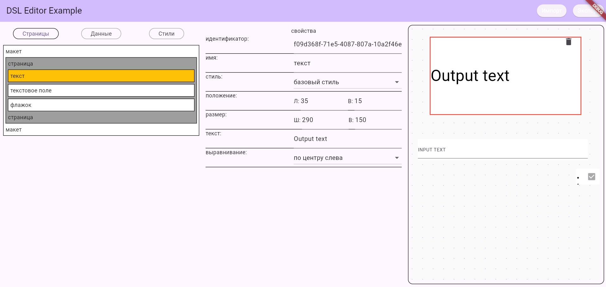

# Frame Forge

[](https://github.com/itjn-ru/frame_forge/blob/main/README.md)
[](https://github.com/itjn-ru/frame_forge/blob/main/README.ru.md)

## Описание
Этот пакет предоставляет визуальный редактор для проектирования и рендеринга пользовательских интерфейсов.
В его основе лежит использование XML как формата описания структуры UI. Изначально разработанный для работы с документами и структурированными данными, он отлично подходит для систем с архитектурой BDUI (Backend-Driven UI).

## Demo
[Жми сюда](https://itjn-ru.github.io/frame_forge/)

## Возможности

### Визуальный UI Редактор
- **Drag & Drop Интерфейс** - Интуитивный визуальный редактор для создания макетов
- **Предварительный просмотр в реальном времени** - Мгновенное отображение изменений при проектировании
- **Поддержка мультиэкранов** - Одновременное проектирование для мобильных, планшетных и десктопных устройств
- **Привязка к сетке** - Точное позиционирование с привязкой к сетке
- **Единое дерево страниц и компонентов** - `PageList` отображает страницы и их компоненты в виде одного раскрывающегося дерева: страницы свёрнуты по умолчанию, expand/collapse по каждому узлу, поиск по страницам и компонентам с авто-раскрытием найденных ветвей, кнопки «развернуть/свернуть всё», быстрый переключатель **Ctrl+K**, переименование/дублирование/удаление страниц (с undo), авто-раскрытие до выбранного на канвасе элемента, запоминание раскрытых узлов в рамках сессии
- **Раскрывающееся дерево компонентов** - `Items` отображает компоненты и вложенные items в виде раскрывающегося списка: по умолчанию виден первый уровень, expand/collapse по каждому узлу, поиск с авто-раскрытием найденных ветвей, кнопки «развернуть/свернуть всё», авто-раскрытие до выбранного на канвасе элемента с подсветкой и прокруткой, запоминание раскрытых узлов в рамках сессии

### Архитектура и Интеграция
- **XML-структура** - Чистая, читаемая разметка описывает UI компоненты и свойства
- **BDUI (Backend-Driven UI)** - Сервер управляет UI без обновления клиентского приложения
- **Динамический рендеринг** - Интерфейс генерируется из данных сервера во время выполнения
- **Сервис-ориентированная архитектура** - Модульный дизайн с внедрением зависимостей

### Удобство Разработки
- **Система Отмены/Повтора** - Полное управление историей с горячими клавишами (Ctrl+Z/Ctrl+Y)
- **Операции Копирования/Вставки** - Эффективное дублирование компонентов и макетов
- **Глобальные обработчики клавиатуры** - Поддержка международных раскладок клавиатуры
- **Управление проектами** - Сохранение/загрузка проектов с пользовательской сериализацией

### Продвинутые Функции
- **Библиотека компонентов** - вариативность UI компонентов за счет добавления стилей
- **Привязка данных** - Соединение UI элементов с динамическими источниками данных
- **Управление стилями** - Централизованная стилизация с поддержкой тем
- **Рабочие процессы** - Определение сложных UI взаимодействий и потоков
- **Адаптивный дизайн** - Адаптивные макеты для различных размеров экрана

### Производительность и Надёжность
- **Эффективный рендеринг** - Оптимизированные обновления дерева виджетов
- **Управление памятью** - Очистка и управление ресурсами
- **Обработка ошибок** - Надёжное восстановление после ошибок и валидация
- **Кроссплатформенность** - Работа на Web, Mobile и Desktop
 
## Motivation
Без изменения кода, загрузки в store изменять UI и обмен данными с сервером приложения клиента.   



## Использование

### Единое дерево страниц и компонентов (PageList)

`PageList` отображает всю структуру страниц с компонентами в одном виджете:
верхний уровень — список страниц, а раскрытие страницы показывает дерево её
компонентов (вложенные группы раскрываются так же).

- все страницы свёрнуты по умолчанию — виджет открывается компактным списком страниц,
- клик по строке страницы делает её текущей; клик по компоненту выбирает его —
  если компонент принадлежит другой странице, редактор сначала переключается на неё,
- поле поиска фильтрует страницы и элементы по названию и автоматически раскрывает
  найденные ветви,
- кнопки «развернуть всё» / «свернуть всё» управляют деревом целиком,
- раскрытые узлы запоминаются в рамках сессии, в том числе при переключении страниц,
- выбор компонента на канвасе автоматически раскрывает ветку до него, подсвечивает
  и прокручивает к нему,
- для строк страниц работают двойной клик (переименование) и правый клик
  (контекст-меню: переименовать / дублировать / удалить); для компонентов —
  стандартное контекст-меню компонентов.

```dart
Scaffold(
  body: PageList(controller, showQuickSwitcher: false),
)
```

Программное управление страницами: `controller.switchPage(page)`, `addPage()`,
`duplicatePage(page)`, `renamePage(page, name)`, `deletePage(page)` — все операции с undo.
Быстрый переключатель: **Ctrl+K** (Scaffold редактора должен использовать `kNodeEditorWidgetKey`).

### Раскрывающееся дерево компонентов (Items)

`Items` отображает иерархию компонентов/items в виде компактного раскрывающегося списка:

- по умолчанию виден первый уровень, более глубокие уровни раскрываются по шеврону,
- поле поиска фильтрует элементы по названию и автоматически раскрывает найденные ветви,
- кнопки «развернуть всё» / «свернуть всё» управляют деревом целиком,
- раскрытые узлы запоминаются в рамках сессии, в том числе при переключении страниц,
- выбор компонента на канвасе автоматически раскрывает ветку до него, подсвечивает
  и прокручивает к нему,
- клик выбирает строку, правый клик открывает контекст-меню (поведение не изменилось).

Обе панели опциональны: `Items(item, controller, showSearchBar: false)` скрывает поиск,
`showToolbar: false` — кнопки «развернуть/свернуть всё».

```dart
Items(controller.layoutModel.root.items.whereType<SourcePage>().first, controller)
```

Те же переключатели есть у `PageList`: `showSearchBar`, `showToolbar` и
`showQuickSwitcher`.

### Создать DSL модель
- Добавить нужные размеры экранов для LayoutModel.
- Создать контроллер

```dart
  final LayoutModel layoutModel = LayoutModel(
    screenSizes: [ScreenSizeEnum.mobile, ScreenSizeEnum.desktop],
  );
  
  late final LayoutModelController _layoutModelController =
      LayoutModelController(
        layoutModel: layoutModel,
        projectSaver: (map) async {
          // Здесь можно настроить сохранение проекта
          return true;
        },
        projectLoader: (isSaved) async {
          /// Загрузка модели из файла
          final FilePickerResult? result = await FilePicker.platform.pickFiles();
          if (result == null) return null;
          final PlatformFile file = result.files.first;
          return utf8.decode(file.bytes! as List<int>);
        },
      );
```
Если есть желание использовать на клавиатуре хоткеи: copy/past/undo/redo, надо инициализировать HardwareKeyboard instance с хандлером.

```dart
void initState() {
    //listen to controller events to update UI
    _layoutModelController.eventBus.events.listen(_handleControllerEvents);
    // Register global keyboard handler
    HardwareKeyboard.instance.addHandler(_layoutModelController.keyboardHandler.handleKeyEvent);
    super.initState();
  }
```


### Основные компоненты

Вывод компонентов макета:
```dart
Column(
  children: [
    Items(layoutModel.root, layoutModel),
  ],
),
```

Вывод источников-переменных макета:
```dart
Column(
  children: [
    Items(
        layoutModel.root.items
            .whereType<SourcePage>()
            .first, layoutModel,
    ),
  ],
),
```

Вывод стилей макета:
```dart
Column(
  children: [
    Items(
        layoutModel.root.items
            .whereType<StylePage>()
            .first, layoutModel, 
    ),
  ],
),
```

Вывод процессов макета:
```dart
Column(
  children: [
    ProcessItems(
        layoutModel.root.items
            .whereType<ProcessPage>()
            .first,layoutModel,
    ),
  ],
),
```

Вывод вьюшки, как страница выглядит
Обязательно указать размер экрана из [ScreenSizeEnum]
```dart
LayoutBuilder(
    builder: (context, constraints) {
        return Consumer<LayoutModel>(
            builder: (context, value, child) {
                return ComponentsAndSources(value,constraints, screenSize);
            },
        );
    }
),
```
